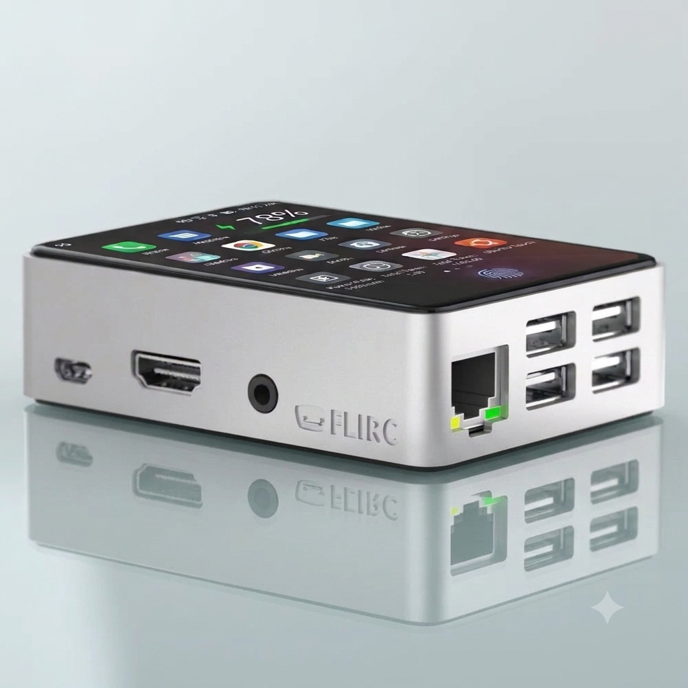
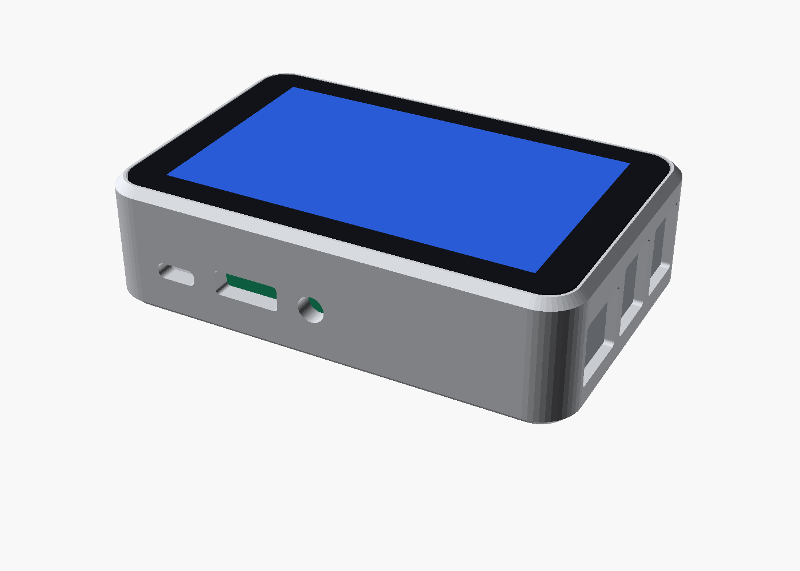
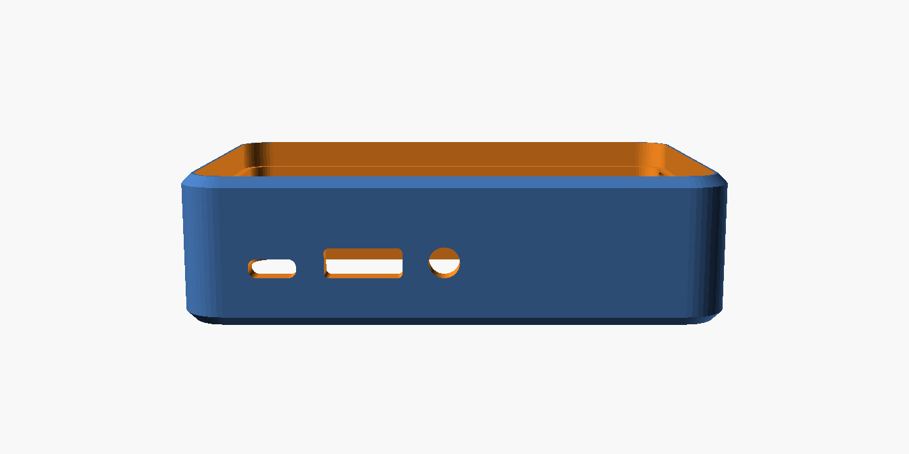

# 섀시 (Chassis) — "그냥 칩이 아니라 보관함"

기기 조립 모델은 [reference/After.png](reference/After.png)입니다. 낮고 둥근 은색 금속 몸체에 Raspberry Pi 5가 들어가고,
**윗면 전체가 터치스크린**입니다. 화면만 보면 Phone, 옆면 HDMI에 모니터를 꽂으면 Desktop입니다.

| 기준 디자인 | 이 저장소의 케이스 모델 ([case.scad](case.scad)) |
|---|---|
|  |  |



## 구성

| 부분 | 부품 / 방법 |
|---|---|
| 기판 | Raspberry Pi 5 (4GB 이상, 8GB 권장) |
| 윗면 화면 | **Waveshare 4inch DSI LCD, 480×800 정전식 터치** — 외곽 104.37 × 65.44 mm, 표시 87 × 52.44 mm |
| 몸체 | 자체 설계 형상 (특정 제품 복제 아님, 상표 각인 없음). 1차는 3D 프린트 후 도장, 맞으면 알루미늄 가공 |
| 외형 | 약 **110 × 71 × 30 mm** (화면 윗면 = 몸체 윗면) |
| 앞면 단자 | 작은 전원(패널형 USB-C ← Pi USB-C), 풀사이즈 HDMI(패널형 ← micro-HDMI), 3.5mm 잭(내장 USB 오디오) |
| 옆면 단자 | 랜 포트, USB 4개 (Pi 5 실제 위치에 구멍) |
| 반대쪽 옆면 | 통풍 슬릿 |
| 바닥판 | Pi 5 스탠드오프(M2.5), SoC 아래 통풍, 고무발 자리 |

이 구성은 이전 작업(Ubuntu_Touch_Raspberry_Onboard, `docs/hardware.md`)에서 정한 것입니다.
5인치 공식 Touch Display 2도 쓸 수 있지만 길쭉해서 After 비율과 많이 달라 대안으로만 둡니다.

## 파일

| 파일 | 내용 |
|---|---|
| [case.scad](case.scad) | 파라메트릭 케이스. `part="body"`(몸체), `part="bottom"`(바닥판) 으로 STL 출력 |
| [config.txt](config.txt) | Pi 5 펌웨어 설정 조각. `os/build.sh rpi5`가 `/boot/firmware/config.txt`에 덧붙임 (`vc4-kms-dsi-waveshare-panel,4_0_inch`) |
| [reference/After.png](reference/After.png) | 기준 디자인 (생성 이미지) |
| [render/](render) | `case.scad` 렌더 |

```bash
openscad -o body.stl   -D 'part="body"'   chassis/case.scad
openscad -o bottom.stl -D 'part="bottom"' chassis/case.scad
```

## 실물로 확인할 항목

- **화면 두께**(`panel_t`)와 **포트 높이**(`port_stack_h`)는 도면에 없어 가정값입니다. 몸체 높이가 이 두 값으로 정해집니다.
- **옆면 USB/이더넷 위치**(`side_ports`)는 Pi 5 기계 도면으로 확인해야 합니다.
- **DSI 커넥터**: Pi 5는 DSI 커넥터가 두 개라, 케이블을 꽂은 쪽에 따라 오버레이에 `,dsi0`이 필요할 수 있습니다.
- **내부 연장 케이블**: 앞면 HDMI·전원·잭은 After 배치를 따르려고 내부 케이블로 옮깁니다. 공간과 고장 지점이 늘어납니다.
- **발열**: 윗면이 화면이라 금속 몸체로 빠지는 방열 경로가 줄어듭니다. 부하 시험(`vcgencmd get_throttled` = `0x0`)으로 확인하세요.
- **Wi-Fi**: 금속 몸체는 내장 안테나 신호를 약하게 합니다. 필요하면 USB Wi-Fi를 씁니다.
- **배터리**: 몸체가 낮아 내장 배터리 공간이 없습니다. 외장 USB-C 보조배터리(5V 5A 권장)를 씁니다. 리튬 셀을 직접 납땜하지 마세요.
- **소리**: Pi 5에는 스피커·마이크·이어폰 잭이 없습니다. 통화에는 USB 오디오(마이크 지원)가 필요합니다.
